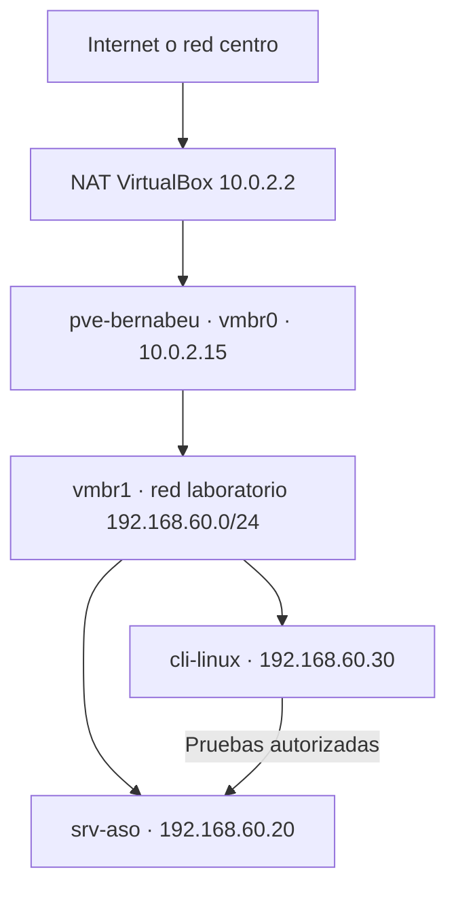

# 02-diagrama-red

## Objetivo

El objetivo de esta parte es diseñar la red del laboratorio que usaremos antes de instalar ningún servicio, definiendo el nodo Proxmox, sus bridges, el direccionamiento de las máquinas, los puertos necesarios y las medidas de aislamiento.

## Diseño de Red

**Nodo Proxmox:** pve-bernabeu.

**Interfaz de gestión:** nic1 (adaptador 2 solo-anfitrión), asociada con el vmbr1 con IP 192.168.60.10/24.

**Bridge de Proxmox:**

| Bridge | Puerto | IP | Uso |
|---|---|---|---|
| vmbr0 | nic0 (adaptador 1, NAT) | 10.0.2.15/24, gw 10.0.2.2 | Salida a Internet |
| vmbr1 | nic1 (adaptador 2, solo-anfitrión) | 192.168.60.10/24 | Gestión y laboratorio |

Las interfaces se llaman `nic0` y `nic1` por la opción "Pin network interface names" del instalador de Proxmox (sin esa opción serían `enp0s3` y `enp0s8`).

**Red o VLAN de laboratorio:** 192.168.60.0/24 (solo-anfitrión), sin VLAN.

**IPs de las VMs/LXC:** srv-aso 192.168.60.20 y cli-linux 192.168.60.30 (ver tabla).

**Gateway y DNS:**
- Gateway de las VMs: 192.168.60.10 (el nodo).
- Gateway del nodo: 10.0.2.2.
- DNS: 10.0.2.3 (DNS del NAT de VirtualBox).

**Puertos necesarios:**

| Origen → Destino | Puerto | Para qué |
|---|---|---|
| Anfitrión → nodo | 8006/TCP | Panel web de Proxmox |

**Medidas de aislamiento:**
- El laboratorio está en vmbr1, separado de la red del aula.
- Los invitados salen a Internet solo a través del nodo (reenvío y con NAT).
- Previsto para la fase de seguridad: firewall de Proxmox con el panel (8006) solo desde la 192.168.60.1 y cli-linux → srv-aso solo por los puertos del servicio. De momento el firewall está desactivado (ver fase 4).
- Previsto para la fase de seguridad: usuarios con permisos mínimos y SSH sin acceso directo de root. De momento solo existe `root@pam`.

**Tabla de direccionamiento:**

| Elemento | Nombre | IP | Función | Recursos |
|---|---|---|---|---|
| Nodo Proxmox | pve-bernabeu | 192.168.60.10 (vmbr1) y 10.0.2.15 (vmbr0) | Hipervisor | 3 vCPU, 8 GiB RAM, 80 GiB |
| Servidor ASO | srv-aso | 192.168.60.20 | Servicio principal | 2 vCPU, 2 GiB RAM, 12 GiB |
| Cliente | cli-linux | 192.168.60.30 | Pruebas | 1 vCPU, 1 GiB RAM, 8 GiB |

**Diagrama de red:**

[Volver al indice](../README.md)
