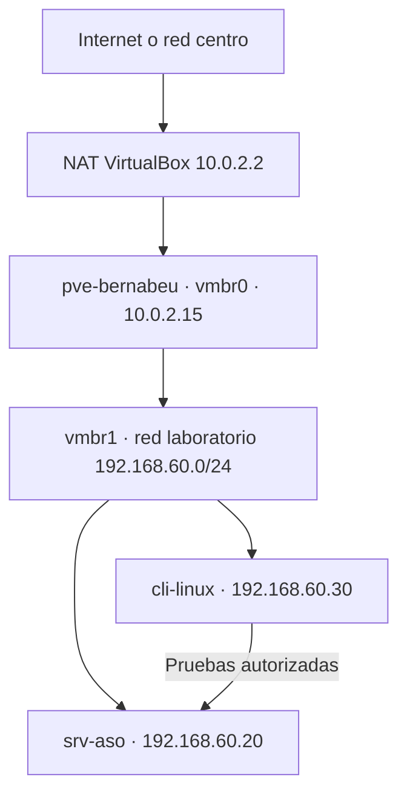

# 02-diagrama-red

## Objetivo

EL objetivo de esta parte es diseñar la red del laboratorio que usaremos antes de instalar ningún servicio, definiendo el nodo Proxmox, sus bridges, el direccionamiento de las máquinas, los puertos necesarios y las medidas de aislamiento.

## Diseño de Red

**Nodo Proxmox:** pve-bernabeu.

**Interfaz de gestión:** enp0s8 (adaptador 2 solo-anfitrión), asociado con el vmbr1 con IP 192.168.56.10/24.

**Bridge de Proxmox:**

| Bridge | Puerto | IP | Uso |
|---|---|---|---|
| vmbr0 | enp0s3 (adaptador 1, NAT) | 10.0.2.15/24, gw 10.0.2.2 | Salida a Internet |
| vmbr1 | enp0s8 (adaptador 2, solo-anfitrión) | 192.168.56.10/24 | Gestión y laboratorio |

**Red o VLAN de laboratorio:** 192.168.60.0/24 (solo-anfitrión), sin VLAN.

**IPs de las VMs/LXC:** srv-aso 192.168.56.20 y cli-linux 192.168.56.30 (ver tabla).

**Gateway y DNS:**
- Gateway de las VMs: 192.168.56.10 (el nodo).
- Gateway del nodo: 10.0.2.2.
- DNS: 8.8.8.8 (DNS de Google).

**Puertos necesarios:**

| Origen → Destino | Puerto | Para qué |
|---|---|---|
| Anfitrión → nodo | 8006/TCP | Panel web de Proxmox |

**Medidas de aislamiento:**
- El laboratorio está en vmbr1, separado de la red del aula.
- Los invitados salen a Internet solo a través del nodo (reenvío y con NAT).
- Firewall de Proxmox: el panel (8006) solo desde la 192.168.56.1, y cli-linux → srv-aso solo por los puertos indicados.
- Usuarios con permisos mínimos y SSH sin acceso directo de root.

**Tabla de direccionamiento:**

| Elemento | Nombre | IP | Función | Recursos |
|---|---|---|---|---|
| Nodo Proxmox | pve-bernabeu | 192.168.56.10 (vmbr1) y 10.0.2.15 (vmbr0) | Hipervisor | 2 vCPU, 6-8 GB RAM, 80 GB |
| Servidor ASO | srv-aso | 192.168.56.20 | Servicio principal | 1-2 vCPU, 1-2 GB RAM |
| Cliente | cli-linux | 192.168.56.30 | Pruebas | 1 vCPU, 512 MB-1 GB RAM |

**Diagrama de red:**

[Volver al indice](../README.md)
