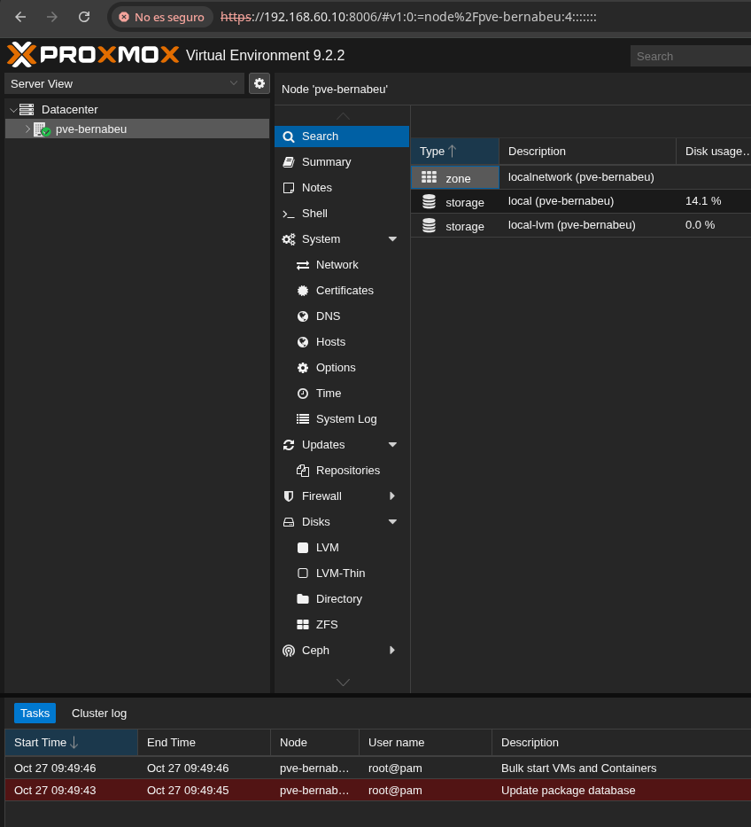
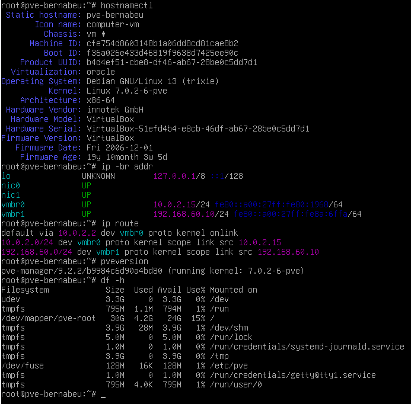
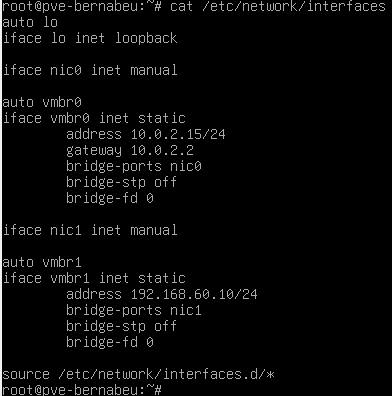

# 03-instalacion-proxmox
 
## Objetivo
 
El objetivo de esta fase es instalar Proxmox VE dentro de una máquina virtual de VirtualBox (modalidad virtualizada), configurar su red siguiendo el diseño de la fase 2 y comprobar que se puede administrar desde el navegador del equipo anfitrión.
 
## Procedimiento
 
**Equipo anfitrión (PC de prácticas):**
 
| Dato | Valor |
|---|---|
| VirtualBox | 7.2.4 r170995 |
| CPU | Intel (Alder Lake), con VT-x |
| RAM | 15,4 GiB |
| Disco | 428,8 GiB (unos 287 GiB libres) |
 
**Máquina virtual `pve-bernabeu`:**
 
| Opción | Valor |
|---|---|
| Tipo | Linux, Debian (64-bit) |
| CPU | 2 vCPU |
| RAM | 8 GiB |
| Disco | VDI dinámico de 80 GiB en controlador SATA (AHCI) |
| ISO | proxmox-ve_9.2-1.iso en controlador IDE |
| Adaptador 1 | NAT (Intel PRO/1000) |
| Adaptador 2 | Solo-anfitrión, red 192.168.60.1/24 sin DHCP, modo promiscuo "Permitir todo" |
 
Con 8 GiB para la VM, el anfitrión conserva unos 7 GiB para su sistema, VirtualBox y el navegador.
 
**Pasos realizados:**
 
1. Crear en VirtualBox la red solo-anfitrión 192.168.60.1/24 con el DHCP desactivado.
2. Crear la VM `pve-bernabeu` con los valores de la tabla.
3. Arrancar desde la ISO e instalar Proxmox VE con estos datos:
   - Disco: `/dev/sda` (80 GiB), sistema de archivos ext4.
   - País y zona horaria: Spain, Europe/Madrid. Teclado: Spanish.
   - Interfaz de gestión: `nic0` (NAT).
   - Hostname: `pve-bernabeu.lab.test`.
   - IP: 10.0.2.15/24, gateway 10.0.2.2, DNS 10.0.2.3.
4. Retirar la ISO y reiniciar.
5. Configurar desde la consola del nodo el segundo bridge `vmbr1` (192.168.60.10/24) sobre `nic1`, en `/etc/network/interfaces`, y aplicarlo con `ifreload -a`.
6. Ajustar `/etc/hosts` para que `pve-bernabeu.lab.test` apunte a 192.168.60.10.
7. Abrir el panel web desde el navegador del anfitrión en `https://192.168.60.10:8006` con el usuario `root`.
**Resultado de la red del nodo:**
 
| Bridge | Puerto | IP | Uso |
|---|---|---|---|
| vmbr0 | nic0 (NAT) | 10.0.2.15/24, gw 10.0.2.2 | Salida a Internet |
| vmbr1 | nic1 (solo-anfitrión) | 192.168.60.10/24 | Gestión y laboratorio |
 
Con la opción "Pin network interface names" del instalador, las interfaces se llaman `nic0` y `nic1` en lugar de `enp0s3` y `enp0s8`. Como DNS se ha usado 10.0.2.3 (DNS del NAT de VirtualBox).
 
## Comandos usados
 
```bash
ip -br link                                   # ver interfaces y MAC
cp /etc/network/interfaces /root/interfaces.bak   # copia de seguridad de la red
nano /etc/network/interfaces                  # añadir nic1 y vmbr1
ifreload -a                                   # aplicar la configuración de red
hostnamectl                                   # nombre y sistema del nodo
ip -br addr                                   # IPs de cada interfaz
ip route                                      # rutas y gateway
pveversion                                    # versión de Proxmox
df -h                                         # espacio en disco
```
 
## Evidencias
 
**Panel web de Proxmox** abierto desde el anfitrión en `https://192.168.60.10:8006`. Se ve la versión 9.2.2, el nodo `pve-bernabeu` y los almacenamientos `local` (14,1 % usado) y `local-lvm` (0 %).
 

 
**Salidas de comandos en el nodo:**
 
- `hostnamectl`: hostname `pve-bernabeu`, Debian GNU/Linux 13 (trixie), kernel 7.0.2-6-pve, virtualización oracle (VirtualBox).
- `ip -br addr`: `vmbr0` con 10.0.2.15/24 y `vmbr1` con 192.168.60.10/24, ambos UP.
- `ip route`: ruta por defecto por 10.0.2.2 en `vmbr0`, y red 192.168.60.0/24 en `vmbr1`.
- `pveversion`: pve-manager/9.2.2 (kernel 7.0.2-6-pve).
- `df -h`: la raíz `/dev/mapper/pve-root` tiene 30 GB, con 4,2 GB usados (15 %).

 
**Configuración de red** (`/etc/network/interfaces`) con los dos bridges:
 

 
## Incidencias
 
**1. Pantalla negra al arrancar el instalador.**
- Síntoma: el menú de Proxmox aparecía, pero al elegir cualquier opción (gráfica o terminal) la pantalla se quedaba en negro.
- Pruebas: cambiar el controlador gráfico, desactivar la aceleración 3D y arrancar con `nomodeset`. Ninguna funcionó.
- Causa: en el log de VirtualBox (`VBoxManage showvminfo pve-bernabeu --log 0`) aparecía `Guest OS type: 'Other'` y el modo de 64 bits desactivado. La VM estaba creada como de 32 bits y no podía ejecutar el kernel de Proxmox, que es de 64 bits.
- Solución: cambiar en *Configuración → General* el tipo a Linux, Debian (64-bit).
**2. Aviso "No support for hardware-accelerated KVM virtualization detected".**
- Causa: la virtualización anidada (VT-x anidado) estaba desactivada en la VM.
- Estado: se continuó con la instalación porque no la afecta. Queda pendiente activarla con la VM apagada (`VBoxManage modifyvm "pve-bernabeu" --nested-hw-virt on`) y comprobarla con `grep -c vmx /proc/cpuinfo`. Si no funciona, `srv-aso` y `cli-linux` se desplegarán como LXC.
## Conclusion
 
Proxmox VE 9.2 queda instalado en la VM `pve-bernabeu` de VirtualBox, con los dos bridges del diseño de red y el panel accesible desde el anfitrión en 192.168.60.10:8006. Queda pendiente activar la virtualización anidada antes de desplegar las máquinas del laboratorio.
 
[Volver al indice](../README.md)
