# 03-instalacion-proxmox
 
## Objetivo
 
El objetivo de esta fase es instalar Proxmox VE dentro de una máquina virtual de VirtualBox (modalidad virtualizada), configurar su red siguiendo el diseño de la fase 2 y comprobar que se puede administrar desde el navegador del equipo anfitrión.
 
## Procedimiento
 
**Equipo anfitrión (PC de prácticas):**
 
| Dato | Valor |
|---|---|
| VirtualBox | 7.2.4 r170995 |
| CPU | Intel (Alder Lake), con VT-x |
| RAM | 15,4 GiB |
| Disco | 428,8 GiB (unos 287 GiB libres) |
 
**Máquina virtual `pve-bernabeu`:**
 
| Opción | Valor |
|---|---|
| Tipo | Linux, Debian (64-bit) |
| CPU | 2 vCPU |
| RAM | 8 GiB |
| Disco | VDI dinámico de 80 GiB en controlador SATA (AHCI) |
| ISO | proxmox-ve_9.2-1.iso en controlador IDE |
| Adaptador 1 | NAT (Intel PRO/1000) |
| Adaptador 2 | Solo-anfitrión, red 192.168.60.1/24 sin DHCP, modo promiscuo "Permitir todo" |
 
Con 8 GiB para la VM, el anfitrión conserva unos 7 GiB para su sistema, VirtualBox y el navegador.
 
**Pasos realizados:**
 
1. Crear en VirtualBox la red solo-anfitrión 192.168.60.1/24 con el DHCP desactivado.
2. Crear la VM `pve-bernabeu` con los valores de la tabla.
3. Arrancar desde la ISO e instalar Proxmox VE con estos datos:
   - Disco: `/dev/sda` (80 GiB), sistema de archivos ext4.
   - País y zona horaria: Spain, Europe/Madrid. Teclado: Spanish.
   - Interfaz de gestión: `nic0` (NAT).
   - Hostname: `pve-bernabeu.lab.test`.
   - IP: 10.0.2.15/24, gateway 10.0.2.2, DNS 10.0.2.3.
4. Retirar la ISO y reiniciar.
5. Configurar desde la consola del nodo el segundo bridge `vmbr1` (192.168.60.10/24) sobre `nic1`, en `/etc/network/interfaces`, y aplicarlo con `ifreload -a`.
6. Ajustar `/etc/hosts` para que `pve-bernabeu.lab.test` apunte a 192.168.60.10.
7. Abrir el panel web desde el navegador del anfitrión en `https://192.168.60.10:8006` con el usuario `root`.
**Resultado de la red del nodo:**
 
| Bridge | Puerto | IP | Uso |
|---|---|---|---|
| vmbr0 | nic0 (NAT) | 10.0.2.15/24, gw 10.0.2.2 | Salida a Internet |
| vmbr1 | nic1 (solo-anfitrión) | 192.168.60.10/24 | Gestión y laboratorio |
 
Con la opción "Pin network interface names" del instalador, las interfaces se llaman `nic0` y `nic1` en lugar de `enp0s3` y `enp0s8`. Como DNS se ha usado 10.0.2.3 (DNS del NAT de VirtualBox).
 
## Comandos usados
 
```bash
ip -br link                                   # ver interfaces y MAC
cp /etc/network/interfaces /root/interfaces.bak   # copia de seguridad de la red
nano /etc/network/interfaces                  # añadir nic1 y vmbr1
ifreload -a                                   # aplicar la configuración de red
hostnamectl                                   # nombre y sistema del nodo
ip -br addr                                   # IPs de cada interfaz
ip route                                      # rutas y gateway
pveversion                                    # versión de Proxmox
df -h                                         # espacio en disco
```
 
## Evidencias
 
**Panel web de Proxmox** abierto desde el anfitrión en `https://192.168.60.10:8006`. Se ve la versión 9.2.2, el nodo `pve-bernabeu` y los almacenamientos `local` (14,1 % usado) y `local-lvm` (0 %).
 
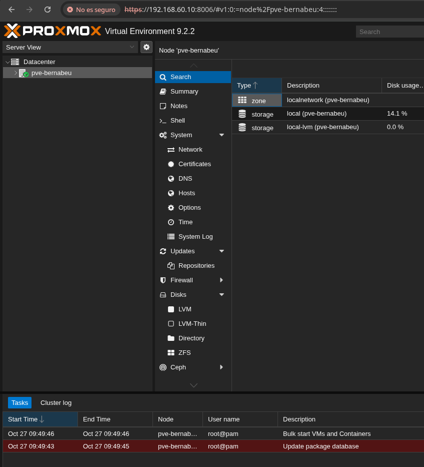
 
**Salidas de comandos en el nodo:**
 
- `hostnamectl`: hostname `pve-bernabeu`, Debian GNU/Linux 13 (trixie), kernel 7.0.2-6-pve, virtualización oracle (VirtualBox).
- `ip -br addr`: `vmbr0` con 10.0.2.15/24 y `vmbr1` con 192.168.60.10/24, ambos UP.
- `ip route`: ruta por defecto por 10.0.2.2 en `vmbr0`, y red 192.168.60.0/24 en `vmbr1`.
- `pveversion`: pve-manager/9.2.2 (kernel 7.0.2-6-pve).
- `df -h`: la raíz `/dev/mapper/pve-root` tiene 30 GB, con 4,2 GB usados (15 %).
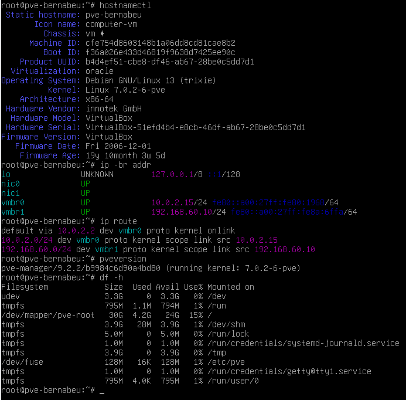
 
**Configuración de red** (`/etc/network/interfaces`) con los dos bridges:
 
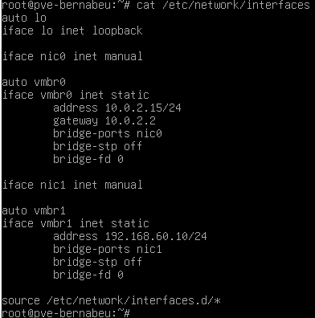
 
## Incidencias
 
**1. Pantalla negra al arrancar el instalador.**
- Síntoma: el menú de Proxmox aparecía, pero al elegir cualquier opción (gráfica o terminal) la pantalla se quedaba en negro.
- Pruebas: cambiar el controlador gráfico, desactivar la aceleración 3D y arrancar con `nomodeset`. Ninguna funcionó.
- Causa: en el log de VirtualBox (`VBoxManage showvminfo pve-bernabeu --log 0`) aparecía `Guest OS type: 'Other'` y el modo de 64 bits desactivado. La VM estaba creada como de 32 bits y no podía ejecutar el kernel de Proxmox, que es de 64 bits.
- Solución: cambiar en *Configuración → General* el tipo a Linux, Debian (64-bit).
**2. Aviso "No support for hardware-accelerated KVM virtualization detected".**
- Causa: la virtualización anidada (VT-x anidado) estaba desactivada en la VM.
- Estado: se continuó con la instalación porque no la afecta. Queda pendiente activarla con la VM apagada (`VBoxManage modifyvm "pve-bernabeu" --nested-hw-virt on`) y comprobarla con `grep -c vmx /proc/cpuinfo`. Si no funciona, `srv-aso` y `cli-linux` se desplegarán como LXC.
## Conclusion
 
Proxmox VE 9.2 queda instalado en la VM `pve-bernabeu` de VirtualBox, con los dos bridges del diseño de red y el panel accesible desde el anfitrión en 192.168.60.10:8006. Queda pendiente activar la virtualización anidada antes de desplegar las máquinas del laboratorio.
 
## Fase 4. Configuración base del nodo

### Objetivo

Comprobar que el nodo tiene una base estable antes de crear las máquinas: dónde se guardará cada cosa, que la red coincide con el diseño de la fase 2, quién puede administrar el nodo y cómo se reparten los recursos.

### Cambios respecto a la instalación de la sesión 05

La VM `pve-bernabeu` se borró y se reinstaló en la sesión 06 (10-11-2026). La instalación sigue el mismo procedimiento de arriba, con estos cambios:

| Elemento | Sesión 05 | Ahora | Motivo |
|---|---|---|---|
| vCPU de la VM | 2 | 3 | Más fluidez y mejor rendimiento, ya que el nodo ejecutará virtualización anidada y con una vCPU más va mejor |
| Disco de la VM | VDI dinámico de 80 GiB | VDI dinámico de 80 GiB (ocupa 4,3 GB) | El profesor pidió reservarlo fijo, pero VirtualBox devolvió `VERR_DISK_FULL`; se dejó dinámico |
| Virtualización anidada | Desactivada | Activada (*Nested VT-x/AMD-V*) | Necesaria para que Proxmox pueda ejecutar VMs KVM |
| Aceleración | — | Paravirtualización KVM y *Nested Paging* | Rendimiento de la VM |
| Red en el instalador | Configurada en el instalador | Sin configurar; se hizo después a mano | Indicación del profesor |

Tras instalar, `/etc/network/interfaces` se configuró a mano con los dos bridges y `/etc/hosts` se corrigió, porque el instalador había dejado una IP de la red del aula (`10.112.7.107`). Ahora el nombre `pve-bernabeu.lab.test` apunta a `192.168.60.10`.

Configuración de la VM en VirtualBox:

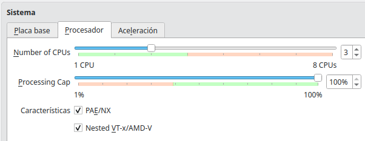

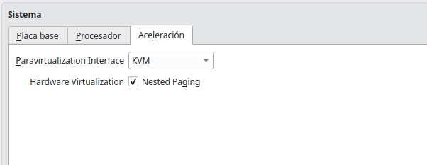

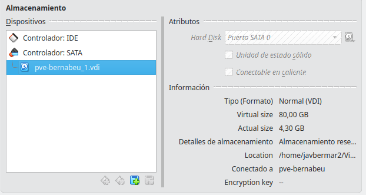

### 1. Almacenamiento

| Almacenamiento | Tipo | Contenido que admite | Espacio libre | Uso previsto |
|---|---|---|---|---|
| `local` | Directorio (`/var/lib/vz`) | Backup, Import, ISO image, Container template | 23,6 GiB de 29,3 GiB (14,15 % usado) | ISOs de Ubuntu Server, plantillas y copias de la fase 9 |
| `local-lvm` | LVM-Thin | Disk image, Container | 29,9 GiB de 29,9 GiB (0 % usado) | Discos de `srv-aso` y `cli-linux` |

Los dos almacenamientos están activos (`pvesm status`) y habilitados en el panel. `local` está en la raíz del nodo (`/dev/mapper/pve-root`, 30 GB con 4,2 GB usados según `df -h`). `local-lvm` no admite ISOs ni copias, por eso las copias irán a `local`, que sí admite *Backup*.

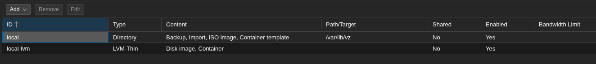

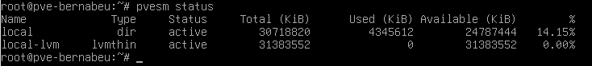

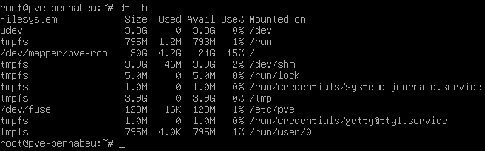

**Espacio del anfitrión:** la partición `/dev/sda6` del PC tiene 198 GB, con 120 GB usados y 69 GB libres (64 %). La carpeta de la VM ocupa de momento 4,3 GB. Al ser un VDI dinámico, crece al usarse, así que hay que vigilar tanto el `df -h` del anfitrión como el almacenamiento de Proxmox.

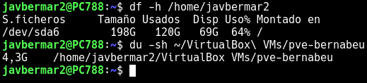

**Riesgo:** las copias se guardarán en el mismo disco que el laboratorio. Si falla ese disco, se pierden a la vez las máquinas y sus copias.

### 2. Red

| Interfaz | Adaptador de VirtualBox | Bridge | IP | Uso |
|---|---|---|---|---|
| `nic0` (MAC 08:00:27:E3:38:C7) | Adaptador 1 (NAT) | `vmbr0` | 10.0.2.15/24, gw 10.0.2.2 | Salida a Internet |
| `nic1` (MAC 08:00:27:DC:75:81) | Adaptador 2 (solo-anfitrión, `vboxnet0`) | `vmbr1` | 192.168.60.10/24 | Gestión y laboratorio |

`ip -br addr` muestra `vmbr0` con 10.0.2.15/24 y `vmbr1` con 192.168.60.10/24, ambos UP. `ip route` muestra la ruta por defecto por 10.0.2.2 en `vmbr0` y la red 192.168.60.0/24 en `vmbr1`. Cada interfaz se ha relacionado con su adaptador por la dirección MAC. Los dos adaptadores tienen el modo promiscuo en "Permitir todo". Coincide con el diseño de [02-diagrama-red.md](02-diagrama-red.md).

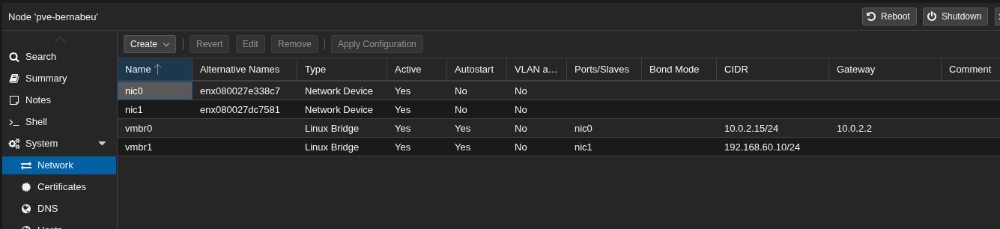

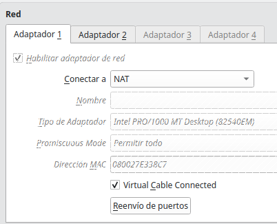

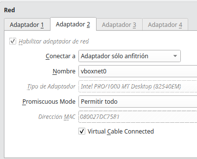

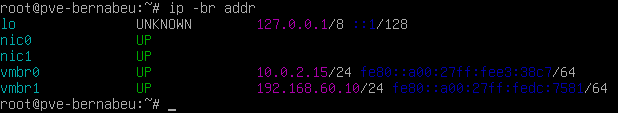

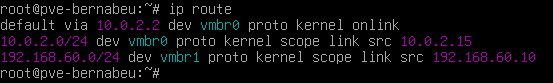

**Conectividad:** el `ping` está bloqueado por el filtrado del centro, así que no sirve como prueba. El DNS resuelve (`getent hosts google.com`) y el nodo accede por HTTPS al repositorio de Debian (`curl -sI https://deb.debian.org` → `HTTP/2 200`).

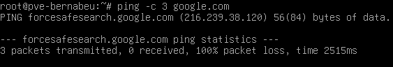

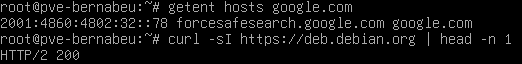

**Repositorios:** `apt update` descarga correctamente los repositorios de Debian (`trixie`, `trixie-updates` y `trixie-security`). Los repositorios `enterprise` de Proxmox devuelven `401 Unauthorized` porque no hay suscripción.

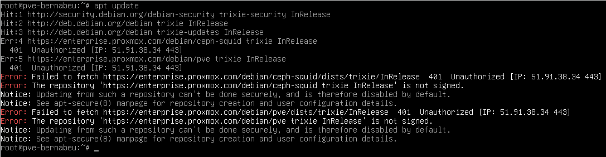

**Virtualización anidada:** `grep -Ec '(vmx|svm)' /proc/cpuinfo` devuelve 6, por lo que Proxmox ve las extensiones de virtualización. Queda probar el arranque de una VM KVM en la fase 6.

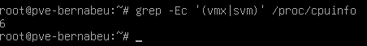

### 3. Accesos administrativos

| Cuenta | Realm | Permisos | Uso |
|---|---|---|---|
| `root@pam` | Linux PAM | Administrador completo del nodo | Administración desde el panel y la consola |

No se han creado usuarios ni roles adicionales porque el profesor no lo ha pedido. Las contraseñas no aparecen en las capturas ni en el repositorio.

El firewall de Proxmox queda **desactivado**, porque no es obligatorio en esta práctica. Medidas de aislamiento del laboratorio:

- La red del laboratorio (192.168.60.0/24) es solo-anfitrión, separada de la red del aula.
- Los invitados solo saldrán a Internet a través del nodo (reenvío y NAT, que se configurarán en la fase 6).
- El panel solo es accesible desde el anfitrión por la red solo-anfitrión.

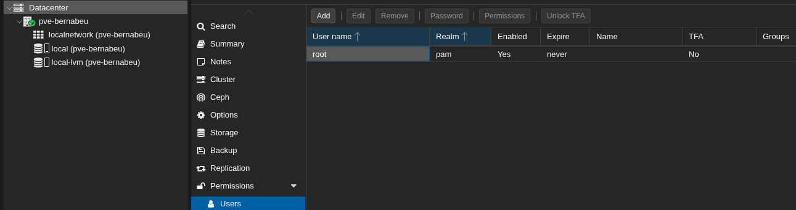

### 4. Reparto de recursos

**Anfitrión:** 15,4 GiB de RAM. La VM usa 8 GiB, así que quedan unos 7 GiB para el sistema, VirtualBox y el navegador.

**VM Proxmox:** 3 vCPU, 8 GiB de RAM.

| Elemento | CPU/vCPU | RAM | Disco o almacenamiento | Motivo del reparto |
|---|---|---|---|---|
| Nodo Proxmox | Comparte las 3 vCPU | 2 GiB | 30 GB (`pve-root`) | Hipervisor y servicios de Proxmox |
| `srv-aso` | 2 vCPU | 2 GiB | 15 GB en `local-lvm` | Ubuntu Server sin interfaz gráfica con Samba |
| `cli-linux` | 1 vCPU | 1 GiB | 10 GB en `local-lvm` | Ubuntu Server sin interfaz gráfica, solo pruebas |
| Plantillas, ISO, copias y margen | — | 3 GiB de margen | `local` (23,6 GiB libres) | ISO de Ubuntu Server (~3 GB), plantilla y copias |

Las vCPU se pueden sobreasignar porque la carga del laboratorio es baja. Con 5 GiB repartidos quedan 3 GiB de margen, de modo que el nodo se puede administrar con el servidor y el cliente encendidos. Los discos de `local-lvm` son *thin*: solo ocupan lo que se usa.

### Comandos usados en la fase 4

```bash
pvesm status                              # almacenamientos y espacio libre
df -h                                     # espacio del nodo
df -h /home/javbermar2                    # espacio del anfitrión (en el PC)
du -sh ~/VirtualBox\ VMs/pve-bernabeu     # tamaño de la VM (en el PC)
ip -br addr                               # IPs de cada interfaz
ip route                                  # rutas y gateway
getent hosts google.com                   # resolución DNS
curl -sI https://deb.debian.org | head -n 1   # salida a Internet por HTTPS
apt update                                # acceso a los repositorios
grep -Ec '(vmx|svm)' /proc/cpuinfo        # virtualización anidada
```

### Incidencias de la fase 4

**3. VM borrada.**
- Síntoma: la VM `pve-bernabeu` desapareció de VirtualBox.
- Solución: reinstalación completa siguiendo el procedimiento de la sesión 05, con los cambios de la tabla anterior.

**4. Error `VERR_DISK_FULL` al crear el disco fijo.**
- Síntoma: VirtualBox no pudo crear el VDI fijo de 80 GB (`VBOX_E_FILE_ERROR`).
- Causa: no había espacio suficiente para reservar el disco completo en `/home/javbermar2`.
- Solución: crear el disco como dinámico.

**5. `ping` bloqueado.**
- Causa: el filtrado de la red del centro bloquea ICMP.
- Solución: comprobar la conectividad con `getent hosts` y `curl`.

**6. `apt update` con error `401 Unauthorized`.**
- Causa: los repositorios `enterprise` de Proxmox requieren suscripción.
- Estado: pendiente de consultar con el profesor si se sustituyen por el repositorio No-Subscription.

### Conclusión de la fase 4

El panel es accesible desde el anfitrión, el nodo tiene la conectividad prevista (DNS y salida por HTTPS), los almacenamientos están disponibles y el reparto de recursos deja margen para continuar. Quedan pendientes los repositorios `enterprise` y la prueba de una VM KVM en la fase 6.

## Correcciones tras la revisión del 19-11-2026

En la revisión del trabajo publicado hasta la fase 4 se indicaron tres puntos a corregir: la mezcla de redes en el diseño, los errores `401` de los repositorios y el cálculo del espacio para la plantilla y las dos máquinas. Se corrigen en la sesión 08 (24-11-2026).

### 1. Red del diseño (192.168.56.0/24 → 192.168.60.0/24)

- Problema: en [02-diagrama-red.md](02-diagrama-red.md) quedaban direcciones de la red 192.168.56.0/24, que es la red solo-anfitrión por defecto de VirtualBox. La red que se usa de verdad es 192.168.60.0/24, la indicada por el profesor y configurada en `vboxnet0`.
- Corrección: se cambian a 192.168.60.0/24 la IP de gestión del nodo (`vmbr1` 192.168.60.10), las IPs de `srv-aso` (192.168.60.20) y `cli-linux` (192.168.60.30), el gateway de las VMs (192.168.60.10), la regla del panel (solo desde 192.168.60.1) y la tabla de direccionamiento.
- Además se han actualizado en el diseño los nombres de interfaz (`nic0` y `nic1`), el DNS (10.0.2.3) y los recursos de cada máquina, para que coincidan con el nodo instalado.
- Comprobación: `/etc/network/interfaces` del nodo tiene `vmbr1` con 192.168.60.10/24 sobre `nic1` (captura `s05-interfaces.png`), igual que el diseño.

### 2. Errores `401 Unauthorized` en `apt update`

- Síntoma: `apt update` daba `401 Unauthorized` en los repositorios `enterprise` de Proxmox (`pve` y `ceph`).
- Causa: los repositorios `enterprise` solo funcionan con una suscripción de pago, y el nodo no la tiene.
- Solución: en *pve-bernabeu → Updates → Repositories* se desactivaron los repositorios `enterprise` de `pve` y `ceph` y se añadió el repositorio `No-Subscription`. Este repositorio no se recomienda para producción, pero es el adecuado para un laboratorio sin suscripción.
- Comprobación: `pve-enterprise.sources` y `ceph.sources` quedan con `Enabled: false`, `proxmox.sources` usa `pve-no-subscription` y `apt update` termina sin errores. No se han instalado las actualizaciones pendientes.


### 3. Espacio para la plantilla y las dos máquinas

#### Cálculo en `local-lvm`

`pvesm status` y `lvs` muestran que `local-lvm` (thin pool `data`) tiene 29,93 GiB y está vacío. La plantilla y las dos máquinas guardarán su disco ahí, porque `local-lvm` es el almacenamiento para discos de VM. `local` (23,6 GiB libres) queda para la ISO de Ubuntu Server y las copias.

| Disco | Tamaño asignado | Almacenamiento |
|---|---|---|
| Plantilla Ubuntu Server | 8 GiB | `local-lvm` |
| `srv-aso` | 12 GiB | `local-lvm` |
| `cli-linux` | 8 GiB | `local-lvm` |
| **Total** | **28 GiB de 29,93 GiB** | Margen de 1,93 GiB |

Con los tamaños de antes (plantilla, 15 GiB y 10 GiB) los discos no cabían si se llenaban. Se han reducido para que quepan incluso en ese caso. Como `local-lvm` es *thin*, en la práctica cada disco solo ocupa lo que usa (una instalación de Ubuntu Server sin interfaz gráfica ocupa unos 4-5 GiB).

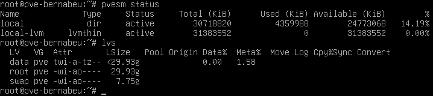

#### Crecimiento del disco virtual en el anfitrión

El VDI de la VM es dinámico: ahora ocupa 4,5 GiB (`du -sh`) y puede crecer hasta 80 GiB. El anfitrión tiene 65 GiB libres (`df -h`), 4 GiB menos que en la sesión 07 porque el PC también se usa para otras prácticas.

- Peor caso: si el VDI llegara a 80 GiB necesitaría unos 75,5 GiB más, y solo hay 65 GiB libres. No cabría.
- Caso previsto: raíz del nodo con ISO y copias (unos 12 GiB) más los discos de las tres máquinas en uso real (unos 13 GiB) dan un VDI de unos 25-30 GiB. Quedarían unos 35 GiB libres en el anfitrión.

Medidas para que no se repita el error de disco lleno:
- Revisar `df -h` en el anfitrión y `du -sh` de la VM antes de crear cada máquina y antes de cada copia.
- Si en el anfitrión quedan menos de 10 GiB libres, no crear más máquinas ni copias y borrar copias antiguas.
- Limitación: el VDI dinámico no se reduce solo al borrar datos dentro de la VM.

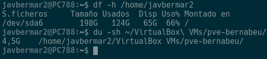


[Volver al indice](../README.md)
